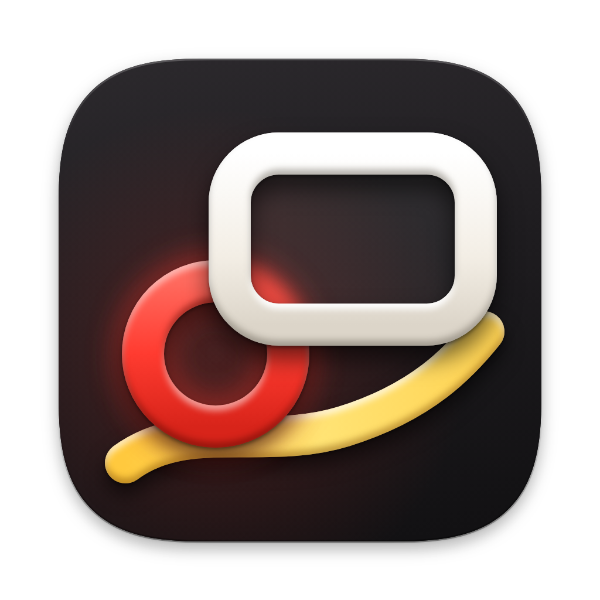

# Annotator

**Capture a screen region on macOS, mark it up with keyboard shortcuts, and copy a PNG to your clipboard.** The installed app lives in the menu bar. Raycast and on-device OCR ("copy text from screen") are optional.

[](LICENSE)
[](https://github.com/rhagerty32/annotator/actions/workflows/ci.yml)

<!-- Replace with a short screen recording or screenshot of the annotation panel -->
<p align="center">
  
  <br />
  <em>Add a GIF or screenshot of the floating editor here when you have one.</em>
</p>

## Features

- **Region, window, or full-screen capture** from the menu bar, a keyboard shortcut, Raycast, or the CLI. Capture uses `screencapture`.
- **Menu bar app** so a shortcut keeps working without Raycast. Launch at Login is in Settings.
- **Floating annotation panel.** The app has no Dock icon while you annotate. **S** copies a compressed PNG and closes the editor. **Esc** cancels. The menu bar app stays running.
- **Keyboard-driven tools:** shapes, arrows, draw, text, spotlight, redact, crop, numbered steps, and more. Press **?** in the panel for the cheat sheet.
- **Copy text from screen:** the same region picker, on-device Vision OCR, and the text on the clipboard.
- **Reopen last shot:** restores the previous capture and its marks.
- **Check for Updates** downloads a signed release and relaunches Annotator. You do not go back to GitHub to replace the app.
- **Raycast extension** in `raycast/` for the same commands. If the menu bar app is already running, Raycast hands the capture to it.

## Install the app

You need **macOS 14 or later**.

1. Download `Annotator.dmg` from [GitHub Releases](https://github.com/rhagerty32/annotator/releases).
2. Open the disk image and drag **Annotator** to **Applications**.
3. Open Annotator. It stays in the menu bar (a viewfinder icon) and opens Settings. Open the app again any time to bring Settings back: double-click it in Finder, use Spotlight, or run `open -a Annotator`. The Raycast command **Annotator Settings** does the same. Capture commands do not open Settings.
4. In Settings, confirm the shortcut for **Capture Region**. The default is **⌃⌥A**. Click the shortcut, then press the keys you want. Press Delete to clear it.
5. Turn on **Launch at Login** if the shortcut should work after a restart.
6. Grant **Screen Recording** when macOS asks. That permission is what capture uses. The shortcut itself does not need Accessibility.

Pick any shortcut other than the macOS screenshot keys **⇧⌘3**, **⇧⌘4**, and **⇧⌘5**. Settings can also bind window, full screen, last region, copy text, and reopen.

If you do not see the viewfinder, macOS may be hiding it. A full or notched menu bar can do that, and on macOS 26 a new app stays off the menu bar until you allow it. Open System Settings, choose Menu Bar, and turn Annotator on under Allow in the Menu Bar. You can still open Settings without the icon, by launching Annotator again.

Later, choose **Check for Updates…** in the menu bar or in Settings. Sparkle downloads the latest release. Choose **Install and Relaunch** and Annotator restarts into that version.

The app is ad-hoc signed. The first time you open it, macOS may say the developer cannot be verified. Right-click Annotator in Finder, choose Open, and confirm. After that, Check for Updates replaces the app in place. Apple Developer ID and notarization are not required.

Raycast is optional. If you use it, its commands keep working and talk to the running menu bar app.

## Install for development

You need **macOS 14+**, [Swift](https://swift.org) (Xcode or Command Line Tools), **Node.js**, and optionally [Raycast](https://www.raycast.com).

```bash
git clone https://github.com/rhagerty32/annotator.git
cd annotator
npm --prefix raycast install
./reload-raycast.sh
```

That builds the app, builds the Raycast extension, and restarts Raycast if it is installed. Quit Annotator from the menu bar before rebuilding if a copy is already running. `./reload-raycast.sh` does that for you.

Then in Raycast:

1. Command Palette → **Import Extension**
2. Choose the `raycast` folder inside this repo (not `dist`)
3. Optional: extension preferences → **Annotator binary** →  
   `/absolute/path/to/annotator/.build/release/Annotator`  
   (usually auto-detected after a build)

Grant **Screen Recording** permission when macOS prompts `screencapture`.

### After a git pull

Raycast caches the old extension until you rebuild and bounce it.

```bash
git pull
./reload-raycast.sh
```

## Build from source

```bash
npm run build:annotator          # swift build -c release
npm --prefix raycast run build   # Raycast extension only
./reload-raycast.sh              # both + Raycast restart
```

Binaries: `.build/release/Annotator` and `.build/release/Capture`. The Annotator binary links Sparkle. Run it from `.build/release` so that framework can be found. The disk image build copies Sparkle into `Annotator.app`.

### App icon and disk image

Ink Trio is the app icon and the drag-to-Applications disk image.

- `assets/icon/ink-trio.png` is the approved 1024 precomposed master. Raycast uses this file.
- `assets/icon/ink-trio.svg` is the vector source. The glass, enamel, and blur live in the raster master.
- `assets/icon/AppIcon-1024.png` is the full-bleed system icon. The dark field fills the square so macOS can mask it.
- `assets/dmg/background.png` (720x440) and `background@2x.png` (1440x880) are the Finder window art. `background.tiff` is the HiDPI image.

```bash
python3 scripts/generate-icons.py
python3 scripts/package-dmg.py
```

`scripts/generate-raycast-icon.swift` copies the master into `raycast/assets/icon.png` (or resamples it). It does not redraw the materials.

On macOS, `package-dmg.py` builds the app, embeds Sparkle, ad-hoc signs it (`codesign --sign -`), and writes `dist/Annotator.dmg` plus `dist/Annotator.app`. That is the build Check for Updates replaces. Developer ID signing is optional.

The Finder window content is 720 by 440 points, icons are 128 points, text is 13 points, Annotator.app is centered at (200, 230), and the Applications alias is centered at (520, 230).

Quick try without opening the menu bar app:

```bash
npm run annotate
```

If the menu bar app is already running, that command hands the capture to it.

## How it works

1. Opening Annotator from the disk image starts a menu bar agent. It listens for the shortcut and for later launches.
2. A shortcut, menu item, Raycast command, or CLI flag starts capture. macOS `screencapture` takes the region, window, or display.
3. Annotator opens a floating panel. **S** copies a compressed PNG and closes the panel. **Esc** cancels. The menu bar agent keeps running. A one-shot launch from the CLI, when the agent is not already running, still quits after you finish.
4. Raycast and `Annotator --capture` connect to the running agent when it is there, so they do not open a second copy.

Copy Text skips the panel: capture, read pixels with Vision, show the HUD, copy the text.

## Usage

### Menu bar

Click the viewfinder. Capture Region, Capture Window, Capture Full Screen, Capture Last Region, Copy Text from Screen, and Reopen Last Shot are in the menu. Settings and Check for Updates are there too. Quit Annotator leaves the menu bar. Closing an annotation does not.

The icon can be missing even when the menu bar is not full. On macOS 26, turn Annotator on under System Settings, Menu Bar, Allow in the Menu Bar. You can Command-drag the icon to move it once it is visible. Launching the app again, or Raycast **Annotator Settings**, opens Settings when the icon is hidden.

The editor's status bar has a **Shortcuts** button that opens the same Settings window. **⌘,** inside the editor is still the canvas (void, chrome, checker), not the global shortcut settings.

### Raycast

Bind hotkeys to whichever commands you use. They launch the binary with the same flags as before.

| Command | What it does |
|---|---|
| **Annotate Screenshot** | Crosshair region, then the editor |
| **Annotate Window** | Click a window, then the editor |
| **Annotate Full Screen** | Display under the cursor, then the editor |
| **Annotate Last Region** | Same rectangle as last time, no crosshair |
| **Annotate in 3s** | Wait 3 seconds, then region capture (menus that vanish) |
| **Annotate Clipboard** | Open whatever image is already on the clipboard |
| **Copy Text from Screen** | Region capture, OCR, clipboard. Edit after you paste. |
| **Reopen Last Shot** | Open the last screenshot and its marks again |
| **Annotator Settings** | Open Settings. Does not start a capture |

### Terminal

```bash
npm run annotate                          # region, then editor
.build/release/Annotator --capture
.build/release/Annotator --capture --window
.build/release/Annotator --capture --fullscreen
.build/release/Annotator --capture --repeat
.build/release/Annotator --capture --delay 3
.build/release/Annotator --clipboard
.build/release/Annotator --ocr            # Copy Text path
.build/release/Annotator --image shot.png
.build/release/Annotator shot.png
.build/release/Annotator                  # menu bar agent
```

### Annotating

Press **?** in the panel for the full cheat sheet. Hold **space** to see every tool, then tap its letter. Space types normally while a text field is active.

| | |
|---|---|
| **Space** | Hold: tool palette · tap a letter to pick |
| **V R C A L D X T** | Select, rectangle, circle, arrow, line, draw, cross, text |
| **H I N B K J** | Fill, spotlight, numbered steps, redact, crop, slice |
| **1–0 −** | Colors (− is black) |
| **[ ]** | Stroke |
| **⇧** | Constrain (square / 45°) |
| **⌥** | Draw from center, or a headless line with **A** |
| **L** | Toggle arrowhead |
| **S** | Copy and close |
| **⌘C** | Copy and stay |
| **⇧S / ⌘S** | Save PNG |
| **Esc** | Deselect, then close |
| **⌘Q** | Quit Annotator, including the menu bar agent |

Drag an arrow’s midpoint to curve it. Drag a rectangle’s top-edge dot to round the corners. **⌘,** opens canvas settings (void, chrome, checker).

### Copy text from screen

Same region picker as annotate. After you release, a small HUD reads the pixels. When it says **Copied**, paste wherever you already were. Esc in the picker cancels.

## Updates

Check for Updates is in the menu bar and in Settings. Sparkle reads:

`https://github.com/rhagerty32/annotator/releases/latest/download/appcast.xml`

A published GitHub Release runs `.github/workflows/release.yml`. The job ad-hoc signs the app, signs the update zip with Sparkle's EdDSA key, and uploads `Annotator.dmg`, `Annotator-<version>.zip`, and `appcast.xml`. Developer ID and notarization are optional and are not required for Install and Relaunch.

The private signing key is the GitHub Actions secret `SPARKLE_PRIVATE_KEY`. The matching public key belongs in `SUPublicEDKey` in `packaging/Info.plist`. Steps are in [CONTRIBUTING.md](CONTRIBUTING.md).

The version Sparkle compares is `CFBundleVersion`. This branch sets it to `1.1.0`, and the release workflow replaces it with the tag (`v1.2.0` becomes `1.2.0`). The next release tag has to be greater than the version people installed.

## Project layout

```
Sources/Annotator/   Swift app (panel, menu bar, settings, updates)
Sources/CaptureKit/  Shared capture helpers + Capture CLI
packaging/           App plist, Finder launcher
raycast/             Raycast extension (launches the binary)
scripts/package-dmg.py
scripts/publish-release.sh
.github/workflows/release.yml
reload-raycast.sh    Build both + restart Raycast
```

## Contributing

We welcome issues and pull requests. See [CONTRIBUTING.md](CONTRIBUTING.md) for build steps, branch flow, and code style. Please read our [Code of Conduct](CODE_OF_CONDUCT.md).

## License

[MIT](LICENSE) © Ryan Hagerty
